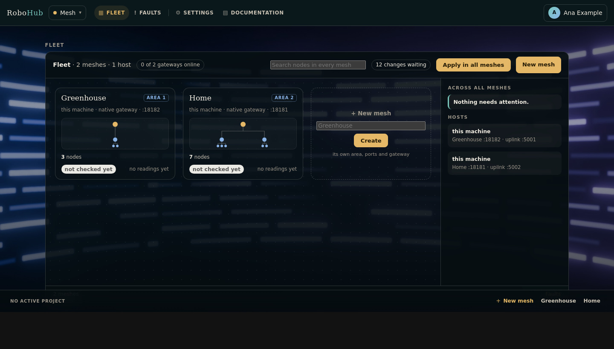
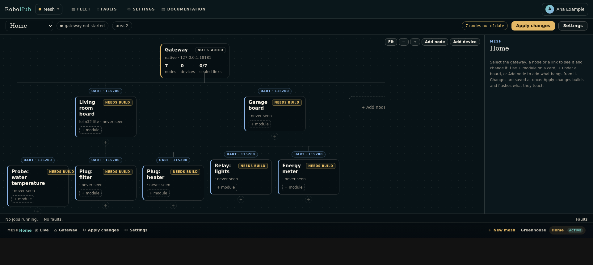

# RoboHub Mesh

Mesh plans and runs the device side of an installation: a gateway, the boards that
report through it, the sensor modules on those boards, the network devices beside
them, the links between them and the firmware each board runs. It draws every mesh
as a tree, writes each board's firmware from the plan, programs it, starts the
gateway, and keeps the readings that come back in the telemetry store the other
applications read. It is the part of RoboHub that knows about boards, not only
about modules.





## Reaching it

| | |
| --- | --- |
| Its own loopback port | `http://127.0.0.1:8478/mesh` |
| The keeper's old address | `http://127.0.0.1:19090/app/mesh/mesh` redirects to the port above (robohub:ADR-0016) |
| Unit | `mesh` (systemd user unit the keeper writes) |

Mesh is a keeper-hosted application: the keeper installs it, runs it and serves it
under its own origin ({ref}`keeper/index`). Its front door is `/mesh`, the fleet of
every mesh; a mesh opens at `/mesh/p/<project>`.

```sh
# ${ROBOHUB_WORKSPACE} holds robohub, robohub-drivers, robohub-devices and this repository.
rho build .
./build/mesh                 # by hand; normally the keeper starts it
```

### Signing in

Mesh trusts the sessions and tickets the keeper issues. Started by the keeper, it
fetches the keeper's public key from the keeper on its machine; started elsewhere,
it is told where the keeper is with `RHO_AUTH_URL`, sends a person there to sign in,
and fetches the key from `<RHO_AUTH_URL>/auth/public-key`, keeping a copy (0600, in
`auth/issuer.pem` of its workspace, or `~/.rho/auth-app/mesh/` when started by hand)
so a keeper that is briefly down locks nobody out. A ticket signed by any other key is
refused. When the keeper rotates its key, a ticket naming the new key makes Mesh fetch
it again (at most every thirty seconds), and tickets of the old key stop working. A
key file at `~/.rho/auth/public.pem` (or `RHO_AUTH_PUBLIC_KEY`) is used instead of
fetching when the machine has one.

Without a keeper, `RHO_AUTH_STANDALONE=1 ./build/mesh` runs Mesh on its own: it
answers requests from its own machine as the local user and refuses any from
another machine or through a proxy.

### Who may do what

Mesh reads the grants the keeper put in a person's ticket (given under Users &
access in the keeper):

| Grant | May |
| --- | --- |
| `*`, `mesh:*` | everything |
| `mesh:read` | read every mesh |
| `mesh:<mesh>` | read and change that mesh |
| `mesh:<mesh>:read` | read that mesh |

A new mesh, copying one, applying in every mesh and Mesh's own settings need
`mesh:*`. Someone granted particular meshes sees a fleet of those only, and finds
only in those when searching. A gateway's token (`gateway:<mesh>:*`) is what Mesh
presents to a gateway; it opens none of Mesh's own pages or API.

Only these are public: `/healthz`, the sign-in callback, static files and
translations, this guide (`/mesh/docs`), and `/mesh/api/nodes/key`, which checks a
host node's own credential with the keeper. They are the auth middleware's
`skip_paths` in `project.yml`. Every other page and API checks the grants itself as
well, and refuses a request the middleware did not authenticate, so a path the
middleware were ever to leave unguarded opens nothing; the guide shows no mesh to
someone who has not signed in.

## Pages

The top bar has **Fleet**, **Faults**, **Settings** and **Documentation**; the bar
at the bottom lists every mesh, with **New mesh** beside them. The keeper and the
other applications are in the app switcher.

| Page | Address | What it does |
| --- | --- | --- |
| Fleet | `/mesh` | Every mesh as a card, new meshes, a mesh imported from a project file, faults across meshes, search |
| Agora | `/mesh/p/<project>` | One mesh as a live tree, edited in the inspector |
| Apply changes | `/mesh/p/<project>/apply` | What differs from what runs, and the jobs that apply it |
| Mesh settings | `/mesh/project/<project>/settings` | Name, description, gateway URL, retention, copy, export and import a project file, delete |
| Faults | `/faults` | The fault inbox, cleared one by one |
| Settings | `/settings` | Mesh's own settings |
| Documentation | `/mesh/docs` | This guide, embedded in the program |

### The fleet

`/mesh` shows every mesh this Mesh manages as one panel:

- a card per mesh with its tree drawn small — the gateway, the boards and
  devices under it, their modules — its counts and readings, and whether its
  gateway answers;
- **+ New mesh**, which takes a name and gives the mesh its own folder, area,
  REST port and uplink port, so two meshes run side by side on one machine;
- the inbox of faults across every mesh, and the hosts their gateways run on;
- an activity strip with how many meshes are down and how many faults are open;
- a search that finds a node by its name, id, board, module or device in every
  mesh, and opens it.

Renaming a mesh changes its display name, not its folder. Deleting it stops its
native gateway, removes the folder and frees its place in the fleet.

### The agora

A mesh opens as its agora: the live tree, a bar above it, an inspector beside it
and an activity strip below.

- The gateway is the root, every board branches from its parent, and the badge on
  a branch is the link and names its transport. Modules hang under the board that
  carries them; devices under the gateway or board that owns them.
- Each card says what the mesh reports about it: online with its last reading,
  quiet, or no readings — and, for a board, whether it runs what is planned.
- The bar says whether the gateway answers and offers **Apply changes** when a
  board or the gateway differs from what it runs.

Selecting the gateway, a card or a link badge opens it in the inspector. The project
and the selection are in the address — `/mesh/p/<project>?select=node:<id>` — so two
tabs show two meshes and a link opens the node it names. The wizard's old addresses
(`/mesh/plan`, `/mesh/step/...`, `/mesh/node/<n>`) open the agora with what they
showed selected.

A new mesh opens on the same canvas with three prompts: choose where the gateway
runs, add the first node, apply. On a narrow screen the inspector is a sheet at the
bottom of the page.

### Editing in place

Every edit is made in the inspector and saved at once:

- **Node** — a board's name, description, role (`node`, `relay` or `gateway`), board
  and parent. Moving a board under another keeps its link when the new parent can
  serve it and picks one both can otherwise.
- **Link** — the transport and its settings, for the link the board reaches its
  parent over.
- **Modules** — the modules fitted to the board, with its bus plan.
- **Data** — what the board or device last reported; a device can be polled and
  switched here.
- **Delete** — says what goes with the node (its modules) and asks where what hangs
  from it moves. No other node changes its number or its id.
- **+ node**, **+ module** and **+ device** under any card add what hangs from it.
- The gateway's own inspector sets where it runs and its ports, and builds, starts
  and stops it.

An edit builds nothing and resets nothing. What a board's image is built from — its
board, role, parent, number, link and the link's settings (with the mesh's Wi-Fi when
it has none of its own), its modules, the links it serves, the address it dials when
it dials the gateway, and what the mesh gives every board: its area and the gateway
key its own key is derived from — is its signature, recorded when the board is
programmed. A board whose signature now differs shows as out of date, with what
changed: a new name changes nothing, a new module puts that board alone out of date,
a new link puts the board out of date and asks the gateway or relay serving it to
restart, and another area or another gateway key puts every board and the gateway
out of date. The key is recorded by its scope, never by itself, and a Wi-Fi password
by a digest keyed with the gateway key, never in clear. Rotating a board's
key is not a rebuild: the gateway hands the board its new key.

A record written by Mesh 0.21.0 or earlier names neither the area nor the key, so
what the board was built with cannot be told from it: the board shows out of date,
"recorded by an earlier Mesh without the area and gateway key it was built with",
until it is flashed again, and the gateway until it is restarted.

Each save raises the node's own revision. A form opened before the node's last save
is refused — "changed elsewhere" — rather than written over it.

#### Nodes and modules

A node is one computer. A sensor module is a node of its own — `kind: module` —
attached to a node, and a node can carry any number of them. A module node is never
built or programmed separately; the image of the node it extends carries it.

Modules are read from `robohub-drivers/boards` on every load of the editor, so a
board added to that checkout appears without rebuilding Mesh. Output and transceiver
boards are left out. The first module attached to a node names the example its
image is built from. A native host has no pins: on a native gateway the module
controls are absent.

Each module says how it reaches a bus in its own manifest:

```yaml
board:
  bus:
    type: i2c
    instance: i2c0
    address: "0x77"        # a part with one address
    addresses: "0x76-0x77" # or the range it can be configured in
    cs: auto               # SPI: the node picks a chip select
```

The Modules tab shows a **bus plan**, which is how several modules become one node:

- 1-Wire modules share `onewire0`.
- I2C modules share `i2c0`; two fixed addresses on the same bus conflict, and a
  module with an address range is assigned one that is free.
- SPI modules share the bus lines and each gets a distinct chip select.
- ADC, PWM, GPIO and UART instances are exclusive.

A conflict is shown on the node and that module is left out of the image, so the
parent still builds. A module that says nothing about its bus is listed without a
plan rather than guessed at.

#### Device nodes

A network device is a node of its own too: an integration from `robohub-devices`
(the Shelly Plug M Gen3, a Hoymiles through an OpenDTU, …) attached to a gateway or a
relay. It is never built or programmed. The device editor chooses the integration,
the transport (`http` or `mqtt`), an HTTP address and the device id. An HTTP device
is polled by Mesh's background worker and can be polled and switched from the Data
tab; an MQTT device reaches Mesh through the broker the keeper runs, is read by
the same worker and can be polled and switched from the Data tab too. Switch
actions appear only for a plug, switch or actuator.

#### What a device manifest tells Mesh

Mesh does what a device's manifest in `robohub-devices` says, so a device it has
never seen needs no code here. Over HTTP the manifest names `telemetry.http_path`
and a field map, `telemetry_http_fields`; over MQTT a `telemetry_mqtt` block and a
field map, `telemetry_mqtt_fields`. The plan's address of an MQTT device is its
topic prefix, which fills `{prefix}` in every topic:

```yaml
telemetry_mqtt:
  status_topic: "{prefix}/status/switch:0"   # one topic (a Shelly), or:
  status_topics:                              # several, read as one reading (Tasmota)
    - "{prefix}/stat/RESULT"
    - "{prefix}/stat/POWER"
    - "{prefix}/tele/STATE"
    - "{prefix}/tele/SENSOR"
  online_topic: "{prefix}/tele/LWT"
  online_path: state                          # optional: read the word inside a JSON payload
  online_up: "Online"                         # optional; "true" when not given
telemetry_mqtt_fields:
  # signal | field | unit | type | path | scale
  - "switch|state||onoff|POWER|1"
  - "switch|state||onoff|$|1"                 # the bare payload of stat/POWER
  - "power|power_w|W|f32|ENERGY/Power|1"
actions:
  switch:
    mqtt_topic: "{prefix}/cmnd/POWER"
    mqtt_payload: "{on}"                      # true or false; {ONOFF} is ON or OFF
```

- **One topic or several.** A manifest names `status_topic` or `status_topics`,
  not both. Every listed topic is read, and the messages are merged into one
  reading: a message changes only the fields whose path it carries, each field
  takes its value from the newest message that carries it, and a field no message
  carries keeps its last value (MESH-0029).
- **Paths.** A path is a `/`-separated walk into a JSON payload (`ENERGY/Power`,
  `switch:0/output`). `$` is the whole payload, for a topic whose payload is a bare
  word or number rather than JSON (Tasmota's `stat/POWER` is `ON`); it carries
  nothing in a JSON object or array. A path a message does not carry, or a JSON
  path into a payload that is not JSON, leaves the field as it was and is not an
  error, which is why two lines may name one field with different paths: whichever
  a message carries applies (MESH-0030).
- **Types.** `bool` is a JSON boolean, as it always was. `onoff` is a switch state
  written as a word: `ON`/`OFF`, `true`/`false` or `1`/`0` in any case, as a JSON
  string, boolean or number or a bare payload, stored as 1 or 0. Anything else in
  an `onoff` field is a protocol error: the field keeps its last value and the log
  says so once, until the value changes (MESH-0031). Every other type is a number,
  multiplied by the scale.
- **Online.** When the manifest names an `online_topic`, a device whose newest
  payload there is `online_up` (compared case-sensitively; `true` when the manifest
  does not say, the Shelly's word) is online, anything else is unreachable, and a
  topic that has said nothing is unknown. The Data tab says "Unreachable" and
  `GET /mesh/api/devices` answers `"reachability":"unreachable"`; the values shown
  are then the last the device sent (MESH-0032). With `online_path`, the payload
  is read as JSON and the value at that path is compared instead — Zigbee2MQTT's
  `{"state":"online"}` with `online_path: state` — and a payload that is not JSON
  or does not carry the path is unreachable (MESH-0034).
- **Actions.** An action's `mqtt_topic` and `mqtt_payload` are filled with
  `{prefix}`, `{client}` (`robohub-mesh`), `{on}` (`true` or `false`, as Tasmota and
  a Shelly take it) and `{ONOFF}` (`ON` or `OFF`, as Zigbee2MQTT takes it; it
  refuses a boolean) (MESH-0035). A payload may be single-quoted in the manifest.

The prefix is one topic level. Mesh's broker user may publish only `+/rpc` and
`+/cmnd/POWER` (and the Zigbee topics below) and read only `+/status/#`, `+/online`,
`+/stat/#` and `+/tele/#` (and `zigbee/#`)
(the `bus:` block of its manifest, which the keeper turns into the broker's ACL),
so a device whose prefix has a `/` in it is not reached. A Tasmota device's
FullTopic is set to `%topic%/%prefix%/` and its Topic to one word, such as
`s60-desk`, which is then the device's address in the plan.

A switch is shown in the state the device **reports**, not the one it was told. When
the device takes the command, Mesh records the request as pending and asks the
device for its state — over HTTP it reads the status back at once; over MQTT it
waits for a status message newer than the request that carries the state field, on
whichever of the device's status topics it comes (a Tasmota plug's `stat/RESULT` or
`stat/POWER`; a newer `tele/SENSOR` without the relay says nothing about it). The request is confirmed when
the device reports the requested state; until then the Data tab says "on
requested, waiting for the device to report it", and after 30 seconds without that
report, "on requested, unconfirmed" — beside the state the device does report. A
device whose integration names no `state` field for its transport cannot report
its state, so its switch is always shown as requested and unconfirmed rather than
as done. A **Poll device** reading, or the next request, ends an unconfirmed one.
A device that does not take the command changes nothing.

### Zigbee coordinators

A Zigbee device — a Sonoff S60ZBTPF plug, say — is reached through a
**coordinator**: a USB Zigbee radio, such as the Sonoff ZBDongle-E or -P, plugged
into a board of the mesh. Mesh plans the coordinator as a device node, runs
Zigbee2MQTT for it on that board, pairs the devices that join it and reads and
switches them as MQTT devices (ADR-0010).

#### Which boards can host one

A coordinator's manifest says what its board needs (`needs: {host: true,
usb_host: true}`): a machine that runs Zigbee2MQTT and a USB host port. The native
gateway — this machine — has both; a board has them when its manifest declares
`capabilities.host` and `capabilities.usb_host` (the Arduino UNO Q's Linux side
does). A Pico, an ESP32, an STM32 or an AVR board has neither. **Add device**
under the gateway or such a board offers **Add a Zigbee coordinator here**; under
any other parent no coordinator is offered, and moving one there is refused saying
which capability the board lacks. A board holds at most one coordinator.

The coordinator's form asks:

- **Which coordinator** — the coordinators robohub-devices declares.
- **Name** — unique in the mesh and also its address and a topic level (letters,
  digits, `-` and `_`); its base topic is `zigbee/<mesh>/<name>`, so the mesh's id
  must be a topic level too. It cannot be renamed once it started.
- **Serial port** — the entries of `/dev/serial/by-id/` on the board (on this
  machine listed directly, on another board over its ssh login), those that match
  the manifest's `usb.by_id` patterns marked ★ and listed first; or a path typed by
  hand, which must be under `/dev/` with no space, `..` or shell character. Behind
  usbipd or a VM the by-id name can differ from the vendor's, which is why the
  person picks. The coordinator's **Zigbee** tab says when the port does not exist
  or this user cannot read and write it, naming the group that owns it (usually
  `dialout`: `sudo usermod -aG dialout $USER`, then log in again).
- **Channel** — 11 to 26, 15 by default; fixed once Zigbee2MQTT first started,
  since changing it means pairing every device again.

#### Attaching the dongle to WSL

On Windows, the dongle is attached to the WSL machine with
[usbipd-win](https://github.com/dorssel/usbipd-win), from an administrator
PowerShell:

```powershell
usbipd list                      # find the dongle's BUSID (CP210x or CH9102F)
usbipd bind --busid 2-3          # once
usbipd attach --wsl --busid 2-3  # after every replug or reboot
```

It then appears in WSL as `/dev/ttyUSB0` or `/dev/ttyACM0` and under
`/dev/serial/by-id/`. A native coordinator stops when WSL stops; Mesh starts it again
when it starts, once the dongle is attached again.

#### Starting it

The **Zigbee** tab starts, restarts and stops the coordinator. A start:

1. asks the keeper for a **broker user** of the coordinator's own, confined to its
   base topic (`POST /api/v1/bus/users`, with Mesh's own broker credential in an
   `Authorization: Bus mesh:<password>` header read from an owner-only file; the
   keeper is asked on this machine or over https only). The issued password is
   kept owner-only in the mesh's folder (`zigbee/<name>.broker`) and handed to
   Zigbee2MQTT only through its `secret.yaml` — never on a command line, in the
   plan, a log or an unsealed export. Zigbee2MQTT can reach nothing but its own
   coordinator's topics, and never carries Mesh's credential.
2. writes Zigbee2MQTT's **configuration** into the coordinator's data folder,
   `zigbee/<name>/` in the mesh's folder, owner-only: from the robohub-zigbee2mqtt
   plugin's template before the first start — the broker and user, the password and
   network key as `!secret` references to `secret.yaml`, the base topic, the port,
   the adapter the manifest names (`ember`, `zstack`), the channel, network key and
   PAN ids of `GENERATE`, availability on, the web frontend and Home Assistant
   discovery off — and afterwards only the keys Mesh owns (the broker, the user, the
   base topic and client id, the port and adapter), so the network key, the PAN ids
   and everything Zigbee2MQTT writes stay as it wrote them. Lose that folder and
   every device must be paired again; keep it in the backup.
3. **on this machine**, starts `node index.js` from
   `~/.rho/toolchains/zigbee2mqtt/<version>` (the version the plugin pins) with
   `ZIGBEE2MQTT_DATA` set to the data folder and `Z2M_ONBOARD_NO_SERVER=1`, so its
   onboarding page is never served; its pid (`mesh-z2m.pid`) and log
   (`mesh-z2m.log`) are in the data folder, it is stopped by that pid only while
   the process is that Zigbee2MQTT, and the gateway's start and stop leave it
   alone. Node.js must be of a major the plugin names (22 or 24): one `rho keeper
   sync` fetched into `~/.rho/toolchains`, or the one on PATH. When it or the
   pinned Zigbee2MQTT is missing the tab says so; **Install Zigbee2MQTT** runs a
   job that downloads the release source, unpacks it and runs `corepack pnpm
   install --frozen-lockfile` and its build with that Node.js.
4. **on another host board** whose manifest deploys with `docker`, runs the pinned
   image (`ghcr.io/koenkk/zigbee2mqtt:<version>`) in a job over the board's own
   deployment login: a folder `~/robohub-zigbee/<mesh>/<name>` made owner-only on
   the board, the configuration and secret file copied there, and `docker run -d
   --name rh-z2m-<mesh>-<name> --restart unless-stopped --device <port>:<port>`
   with the folder mounted. Zigbee2MQTT there must reach the broker over the
   network, so Mesh refuses, saying why, while the keeper reports that its broker
   listens on this machine only: **an admin opens the broker to the network**
   in the keeper's MQTT settings first (SYS-0032), and the next start writes the
   network address into the configuration.

The tab shows the bridge as online or offline from `<base>/bridge/state`, and the
Zigbee2MQTT version, the coordinator's firmware and the channel from
`<base>/bridge/info`. Removing the coordinator stops its Zigbee2MQTT and removes its
broker user, and keeps its data folder, so a coordinator put back keeps its network;
it is refused while Zigbee devices hang under it. Removing the mesh removes its
coordinators' users too.

#### Pairing a device

1. **Allow joining** opens the coordinator's network for up to 254 seconds (never
   without a bound: a device that joins is handed the network key), with the time
   left shown; **Stop joining** closes it early.
2. Put the device in pairing mode (an S60ZBTPF: hold its button for 5 seconds until
   the LED blinks).
3. The tab lists every device in the retained `<base>/bridge/devices` that is not the
   coordinator and not yet in the plan, with its IEEE address, vendor and model,
   whether Zigbee2MQTT supports it, its interview state and the device manifest whose
   `zigbee.model` (and `zigbee.vendor`) matches it.
4. **Adopt**, with a name, adds a device node under the coordinator — transport
   `zigbee`, that manifest, its IEEE address, the name as its address — and asks
   Zigbee2MQTT to rename the device to that address. The node says **Not renamed yet**
   until Zigbee2MQTT answers that rename's transaction with `ok`, and offers **Rename
   again** when it answered an error. A device whose interview is not `SUCCESSFUL`, or
   that no manifest reads, is listed but not adoptable, saying which.

A Zigbee device is then an MQTT device with the prefix `zigbee/<mesh>/<coordinator>/
<address>`: read by the background worker, polled and switched from its Data tab,
listed in `GET /mesh/api/devices` and the sources, its history and widgets, all as
any MQTT device (MESH-ZB-0014). Its reachability comes from Zigbee2MQTT's
availability (`{"state":"online"}`; a mains device is offline after 10 minutes
unheard). Removing its node asks Zigbee2MQTT to remove it from the network
(`bridge/request/device/remove`), and says so when the coordinator is offline or the
request failed: then reset the device by hand.

#### Carrying a coordinator

The project file (schema 2) carries coordinators with their port and channel and
Zigbee devices with their IEEE addresses. A sealed export also carries each
coordinator's network — the network key, PAN id, extended PAN id, channel and
Zigbee2MQTT's `coordinator_backup.json` — from its data folder; an unsealed one names
it under `omitted:`. An import that brings it writes it beside the new coordinator's
folder, and the first start writes it into Zigbee2MQTT's files instead of `GENERATE`,
so every paired device stays paired; without it every device must be paired again.
For a coordinator on another board, the data folder on this machine holds what Mesh
wrote, not what Zigbee2MQTT wrote there, so its network is not in an export.

#### When it does not work

- **The bridge stays "not heard"**: Zigbee2MQTT did not start or cannot reach the
  broker. Read `zigbee/<name>/mesh-z2m.log` in the mesh's folder; a broker user the
  keeper refused is said on the tab (install MQTT in the keeper; a name clash).
- **"does not exist"**: the dongle is unplugged, or on WSL not attached (`usbipd
  attach --wsl`); with a by-id path, the name may differ behind usbipd: pick it again.
- **"cannot read and write"**: add the user to the group named (`dialout`) and log
  in again; Mesh is restarted by the keeper after that.
- **The ZBDongle-E does not start**: its firmware must be EmberZNet 7.4.4 or newer
  for the `ember` adapter; flash it as the robohub-devices guide says.
- **A device does not join**: open joining again, bring the device close to the
  coordinator, reset it (hold its button), and keep the dongle on a USB extension
  cable away from USB 3 ports and Wi-Fi routers. A channel that clashes with Wi-Fi is
  changed only by pairing everything again.
- **A device joined but cannot be adopted**: wait for the interview to finish; a
  model no manifest reads needs a manifest in robohub-devices first.


### Links

A link offers only transports both boards can serve: the transports the
`robohub-transport` module declares (`capabilities.transports`) that are also in each
board's `capabilities.links`. Today they are UART, USB, Console, WiFi, Socket,
Ethernet, RS-485, SPI and I2C. `Console` is offered only when the parent is a host,
because the console is the host's byte stream.

| Transport | Fields |
|---|---|
| UART / USB / Console / RS-485 | parent endpoint, node endpoint, baud (RS-485 also its address) |
| WiFi | SSID, password, parent host, node host, TCP port |
| Ethernet / Socket | parent interface or host, node address, port |
| SPI / I2C | parent bus, node bus, address |

### Apply changes and jobs

**Apply changes** lists what differs from what runs and what applying will do:
build each changed board and then flash it, and restart the gateway (or build and
program it, when it is a board). A board's inspector can build and flash that board
alone, and the gateway's can rebuild and restart it.

Applying queues jobs and answers at once. Each job is a script beside the project
with its own log; one runner per mesh works through them in order, so a long build in
one mesh never waits on another, and no page waits on a build. A job that depended on
one that failed is skipped. A job opens its log in the inspector, where a failed one
can be tried again.

A node is built from the modules in the plan: Mesh copies the telemetry node
template, writes `src/sensors.c` from the descriptors in `robohub-drivers`, adds every
compatible module and its driver, writes the Kconfig the board and modules need, and
builds with the commands the examples use:

```sh
rho build -target <board> <project>/boards/node_<number>
rho flash -target <board> -project <project>/boards/node_<number> <image>
```

| Transport | Node link in the firmware |
|---|---|
| UART | a hardware UART (`uart1` on the Pico 2 W) |
| USB / Console | USB CDC |
| WiFi / Socket | the TCP sink |

A flash waits on its board's card, with that board's instruction, until you say the
board is in its programming mode — for a Pico 2 W, BOOTSEL: hold BOOT, tap RST,
release RST, then BOOT. Under WSL the flash shares the board with WSL (Windows asks an
administrator once) and attaches it, re-attaches it after the reboot into BOOTSEL,
and falls back to the bootrom's drive. When a flash succeeds the board runs what is
planned and stops showing as out of date.

### Production builds

A production build hardens a board in ways that cannot be undone: an ESP32 burns
eFuses for secure boot v2 and flash encryption, an RP2350 writes its boot key's hash
into OTP and then boots only images signed with that key. It is **off for every
board** until someone turns it on, on that board, in its inspector's **Access** tab
(the plan says `node.<n>.production: on`). The toggle is shown only for a board
whose platform declares a production plan — the file `rho flash --production`
reads, looked up the same way under `<platform>/production/` (the target's name,
its preset, its family, then `production.json`). An ESP32, an RP2350 and an STM32
(RDP level 1, reversible) have one; an RP2040, an AVR board and a Linux host have
none, and turning it on for them is refused. Turning it on shows the warning: the
steps are irreversible, and a board flashed this way cannot go back to a plain
image.

When it is on:

- the board's `project.conf` carries `CONFIG_RH_PRODUCTION=y`, and the board is out
  of date (*production build changed*) until it is built again;
- if the platform's plan names `RH_SECURE_BOOT_SIGNING_KEY` (ESP32: an RSA-3072 PEM
  key; RP2350: a secp256k1 PEM key), the build needs the mesh's **secure-boot
  signing key**: an absolute path on the machine running Mesh, set in the same tab,
  kept in `signing-key.txt` beside the plan (0600) and never in the plan. Mesh
  never reads the key; the build job is given its path as
  `RH_SECURE_BOOT_SIGNING_KEY`. A production build is **not queued** while no key
  is named, the file is not there, or the group or others can read it;
- the build job ends with `rho flash ... --production --dry-run`, written to
  `production-plan.txt` in the board's folder;
- the flash job waits with that printout — every step, irreversible ones marked —
  as its *waiting for you* text, and a field for the board's name. Only the exact
  name lets it run: Mesh writes what was typed beside the job, and the job hands
  it to `rho flash -target <board> -project <dir> <image> --production` on its
  standard input, where rho flash checks it again. On an RP2350 the job sets
  `RH_PICO_OTP_JSON` to the build's `build/output/<program>.otp.json`. There is no
  way past the typing.

Turning the toggle off makes the next build a plain image again — on an ESP32 or
RP2350 that was already flashed for production, that image will not boot: keep the
key, and build for production.

### Linked meshes

A mesh can report through another: in its gateway's inspector, **Reports through**
names the mesh whose gateway carries it. Its gateway then runs as a relay
(robohub-gateway's relay mode): it dials the parent gateway's uplink as a board of
the parent's mesh, with an id of its own (`relay_uid` in its plan) and the key the
parent derives for that id from its own gateway key, written beside the child as
`relay.key`. The parent listens on its uplink while a mesh reports through it.
Linking or unlinking changes both gateways' signatures, so both show that a restart
applies it.

The parent's agora shows each linked mesh as a node under its gateway that opens to
its own tree; the fleet says which mesh reports through which. A mesh cannot report
through itself or through a mesh that reports through it.

### Across meshes

- **Move to another mesh**, on a board's or device's Node tab, moves it with its id,
  its modules and its history; what hangs from it stays, under its parent. It is out
  of date until it is built with the other mesh's key.
- **Copy as a template**, on a mesh's settings page, starts a new mesh with the plan —
  gateway, boards, modules, links — and its own area and ports, and nothing of what
  was deployed.
- **Apply in all meshes**, on the fleet's bar while changes are waiting, queues each
  mesh's jobs at once.
- **Export and import a project file** carries a mesh to a file and back, here or on
  another Mesh (below).

### Project files: export and import

A mesh can leave Mesh as one file and come back from it: to back it up or keep it in
git, to move it to another machine, to undo edits older than its last 20 revisions,
or to start another site from its design. The file is the mesh's **definition** —
nothing that only this Mesh recorded.

**What is in it.** YAML by default (JSON on request, the same keys and values):

```yaml
exported: { at: "2026-11-19T10:00:00Z", by: "robohub-mesh 0.21.0" }
format: "robohub-mesh-project"
mesh: { id: "garden", name: "Garden", description: "", area: "5", rest_port: "8081", uplink_port: "5002" }
omitted:
  gateway_key: "the gateway key every board's key derives from"
  node: { 1: { password: "the Wi-Fi password of network GardenNet" } }
plan:
  gateway: "native"
  node:
    1: { id: "0123456789abcdef", number: "1", name: "Pump board", link: "wifi", ssid: "GardenNet", parent: "gateway" }
    count: "1"
schema: "2"
```

(Mesh writes it as nested maps, one key per line, every value quoted, keys sorted — a
node row by its number — so two exports of an unchanged mesh differ only in
`exported.at` and a renamed board is one changed line.) `plan:` holds the plan's own
definition keys: the gateway (role, board, driver, sensors, host, serial device, TLS
file paths, the URL of a gateway elsewhere), the telemetry retention, every node with
its number, id, kind, role, name, description, board, driver, parent, link and link
settings, its module or device, its key epoch, revocation and production setting, the
relay id and the meshes it reports through or that report through it. Never in it:
the plan's revision, steps, status and messages, device states and last values,
telemetry, faults, jobs, logs, revisions, built images, token records, registered
clients or Mesh's own settings. The schema is published as
`schemas/mesh-project.v2.json` (JSON Schema 2020-12; schema 1 stays as `v1`) in Mesh's repository; an editor
can check a file against it without Mesh.

**Secrets.** An ordinary export leaves out the gateway key, the relay key, every
Wi-Fi password, a legacy gateway token and the production signing key, and lists
each one under `omitted:` by name — never its value — so it is safe to share and
commit. **Export with the secrets, sealed** puts the gateway key, the Wi-Fi passwords
and the record of what each board runs in `sealed:`, encrypted with AES-256-GCM under
a key PBKDF2-HMAC-SHA256 derives (600 000 iterations, random salt) from a passphrase
of at least 12 characters you type twice; the block is bound to the file's format,
schema, mesh id and export time, so it cannot be moved into another file. Mesh never
keeps, logs or passes on the passphrase, and the relay key (derived again from the
parent's key) and the signing key (a file of the machine) are never exported. A
forgotten passphrase costs a rebuild and reflash of every board, nothing more.

**Three ways to import.**

| Mode | What happens |
| --- | --- |
| **New mesh** (fleet page, *Import a mesh*) | A mesh under the file's id — or, when this Mesh has a mesh or folder of that id, one made from the name — with every node's number and id, the file's area and ports when no other mesh here has them (otherwise the fleet's, listed), and the gateway key when the sealed block is opened. With the key, the area, the uplink port and every number and id kept, the boards that were current stay current: a mesh moved whole needs nothing built or flashed. Anything less and every board and the gateway are never programmed, with a new key. |
| **Copy** (fleet page) | What *Copy as a template* does: the file's gateway, boards, modules, devices and links with new node ids, a new key, no secret, nothing deployed and no link to another mesh. For a second site. |
| **Over this mesh** (a mesh's settings page) | The plan's definition is replaced in one write, after you type the mesh's name. The mesh keeps its id, folder, area, ports, gateway key — whatever the file carries — deployed records, tokens, jobs and history, and the Wi-Fi passwords of the nodes the file keeps when the file has none; the plan it replaces is kept as a revision even if one was kept a moment before. Importing a file whose definition is already the mesh's writes nothing. |

**Preview first.** Every import is first a preview that writes nothing: the mesh's id
and name, each node added, changed or removed, each area or port that is not the
file's, the secrets kept and those not in the file, the boards that will be out of
date, what the gateway's node manifest will admit, refuse or revoke (for an overwrite),
every conflict and how it is settled, and every warning. The confirmation names the
file by its SHA-256, so another file is refused. Settled for you and listed: a mesh id
taken (a new id, or import over it), an area or port taken (the fleet's), a link to a
mesh that is not here (left out). Refused, with a copy offered: node ids another mesh
here has, or a sealed gateway key another mesh uses. Warnings: a board, driver,
module or device integration this Mesh's catalog does not have (the node is kept and
its build refused until the catalog has it), a Wi-Fi board whose password the file
left out (its build is refused, naming the network, until a password is entered in its
link), and the gateway's serial device and TLS file paths, which name files of the
machine that exported them — they are imported as written; check them here.

**Checked whole, applied whole.** A file is checked before anything is written and
every problem is listed with its key and, for YAML, its line: a line that is not a key,
a key and a value, a comment or blank (lists, inline maps, anchors and multi-line
values are refused), an unknown key, a value outside its pattern, two nodes with one
number or id, a parent, module board or link that names no node, a ring of parents, a
second gateway, more than 64 nodes, a file over 1 MiB. A file of a newer schema is
refused, naming its schema, Mesh's own and the Mesh that wrote it; an older one is
carried forward. A new mesh is written in a hidden folder and renamed into place, its
fleet place given back if that fails, and Mesh clears anything an interrupted import
left when it starts. An import queues no job and starts, stops or restarts no gateway:
Apply stays a deliberate act. Nothing in a file is run, put on a command line or
followed as a path, and a mesh id is taken from it only as a safe folder name.

**Who may.** Exporting without secrets needs a grant that reads the mesh; exporting
the sealed secrets and every import need Mesh as a whole (`*` or `mesh:*`). Pages post
with the form token, programs with a bearer ticket; anything else is `403`.

## Settings

**Mesh's settings** (`/settings`, tabs):

| Tab | What it holds |
| --- | --- |
| General | Vertical or horizontal tabs. |
| Alerts | The `robohub.alert` channels Mesh binds: the log file and threshold; e-mail on/off, recipient, threshold; Telegram on/off, chat, bot token, threshold. |
| Auth | Read-only: the issuer (the keeper), the mode, the sign-in address. |
| Gateway | Read-only: the gateway provider, route, port and the open mesh. |
| Storage | Telemetry retention: raw readings (14 days), minute roll-ups (90), hourly roll-ups (1825), faults (365); WAL checkpoint (5 minutes); retention pass (6 hours); vacuum mode; maximum gateway backoff (60 seconds). |
| Logging | Level, text or JSON, rotating file, size, retention, standard error. |
| Configuration | Read-only: the registry Mesh reads, its plugins, its alert channels. |

**What Mesh raises as an alert.** Faults go to the fault inbox as before; the ones
that need a person are also raised through every `robohub.alert` channel above
whose threshold they meet:

| Fault | Level | When |
| --- | --- | --- |
| A mesh's gateway stops answering | ERROR | the first failed poll of an outage (the inbox's fault); an INFO "answers again" follows when it is back |
| A build or flash job fails | ERROR | per board and kind of job |
| A board's revocation or key rotation cannot be sent to its gateway | ERROR | until it is sent, that gateway still admits the revoked board, or holds the replaced key |

An alert with the same mesh and subject is not raised again within 15 minutes, so a
link that flaps or a job retried in a loop is one message; when each was last raised
is kept beside the mesh's plan (`alert-<mesh>-<subject>.txt`), so a restart does not
forget it.

**A mesh's settings** (`/mesh/project/<project>/settings`): its name, a short
description, the gateway URL it owns, how long its raw readings are kept, **Copy as a
template**, **Export as a project file** (YAML, JSON, or with the secrets sealed),
**Import a project file over this mesh** and **Delete project**. The Storage tab's raw window, when set, applies to
every mesh.

A few keys are written in the mesh's `plan.yml` by hand, while Mesh is stopped:

| Key | What it does |
| --- | --- |
| `gateway_tls_cert`, `gateway_tls_key` | Paths on the gateway's machine; a gateway deployed over SSH or ADB then serves HTTPS, and `gateway_url` is an `https://` address. |
| `gateway_audience` | The gateway is another service that produces readings (energy, for one): Mesh polls it with a token for that audience and the `<audience>:gateway` scope. |

## How it connects to the rest

| What | How |
| --- | --- |
| The keeper | Signs people in; installs and runs Mesh; registers it as a client for the services it calls (`deploy.calls: [gateway, energy]`). |
| Gateways | Each mesh's gateway ({ref}`robohub-gateway/index`), started, deployed or programmed by Mesh. |
| `robohub.bus` | Bound to `robohub-provider-mqtt`: Mesh is a user of the keeper's MQTT broker, publishing `+/rpc`, `+/cmnd/POWER`, `mesh/+/telemetry`, `zigbee/+/+/+/set` and `zigbee/+/+/bridge/request/#`, subscribed to `+/status/#`, `+/online`, `+/stat/#`, `+/tele/#` and `zigbee/#`, and issued broker users under the `zigbee` root (`bus.issue`), one per coordinator. |
| `robohub.alert` | Bound to the log, e-mail and Telegram providers. |
| Shared modules | `ui`, `i18n`, `settings`, `forms`, `notifications`, `htmx`, `logging`. |
| Applications | The aquarium and energy read a mesh through {ref}`robohub-provider-mesh/index`, which implements the gateway contract against Mesh's API. |
| Boards and drivers | Read at run time from the local registry's platform modules and `robohub-drivers` / `robohub-devices`: nothing in the planner names a board or a driver a manifest does not. |

### Where the boards and drivers come from

Boards are found by scanning the local registry for platform modules and reading the
manifests under their `boards/` directories. A board declares its roles and hardware
in `capabilities`:

```yaml
capabilities:
  gateway: true
  relay: true
  node: true
  host: false
  links: "uart console usb wifi socket"
  buses: "uart usb i2c spi onewire gpio adc pwm"
  deploy: "flash"
```

A driver declares what it measures and how a node carrying it is built:

```yaml
capabilities:
  sensor: true
  buses: "onewire"
  measures: "temperature"
deployment:
  boards: "pico2w"
  example: "examples/temperature/ds18b20/c/telemetry"
  binary: "build/output/telemetry.elf"
  kconfig: "CONFIG_RH_HAL_ONEWIRE=y CONFIG_RH_BOARD_DS18B20_MODULE=y ..."
```

A platform board also says how a gateway is deployed to it (`deployment.method`:
`adb`, `ssh`, `flash` or `process`, with its architecture, user and path). Adding a
board or a driver therefore needs no rebuild of Mesh; the next page load finds it.

### Gateway tokens and keys

A gateway's API (`/api/v1/`) answers only a caller with a short-lived token the
keeper issued for the audience `gateway`. Each gateway is started with
`GATEWAY_ID` set to its project, and Mesh presents it a token scoped to that gateway
alone, `gateway:<project>:*`, asked for with Mesh's own client credential: a token
taken from the network opens one gateway. The single `gateway_token` an older project
kept is read once into the project's token records so an old installation keeps
working.

Every frame between a board and its gateway is authenticated (robohub-transport's
`secure.h`). Mesh makes the keys and keeps them out of every repository:

- each mesh has a gateway key, made the first time it is needed and kept in its
  folder (`gateway.key`), readable by Mesh's user only, and installed with the gateway
  as `GATEWAY_KEY_FILE`; a key file that exists is never replaced;
- each planned board has an id (`node.<n>.id` in the plan), made once;
- a board's key is derived from the two and its key epoch (`node.<n>.epoch`, 0
  until it is rotated) and written into its build as `src/robohub_secret.h`,
  with the epoch as `RH_DEVICE_KEY_EPOCH` and the gateway's key scope
  (`RH_KEY_SCOPE`, `HMAC-SHA256(K_gw, "rh-scope1")[0:8]`, which a rotated key is
  stored with so a board moved to another mesh ignores the key it stored for its
  old one); no repository tracks it.

A board built that way says hello to its gateway, opens a session, and sends only
sealed frames; its gateway accepts nothing else (on the serial link,
`ALLOW_PLAIN_FRAMES=1` lets plain frames through while boards are reflashed).

Mesh's tree is its user's alone: every folder is `0700`, and what holds a key or a
password — the generated header, `project.conf`, the built `.elf` and `.uf2` — is
`0600` (builds and jobs run under `umask 077`). Mesh closes what an older version
left readable when it starts.

**The node manifest.** Mesh writes `nodes.txt` beside `gateway.key` — one line per
board, `uid|area|node|role|epoch|revoked|areas` — whenever the plan changes and at
every gateway start, and installs it beside the key on the gateway's host. The
gateway admits only the boards it lists, takes a board's readings only for its own
placement, and an announce only from a `relay` for its own areas (a mesh linked
below is one, for its area and those below it).

**Revoke.** A board's inspector has an **Access** tab: **Revoke** takes the board
out of its mesh without re-keying anything — the plan says `node.<n>.revoked`, the
manifest is rewritten, a gateway on this machine reads it within seconds and one on
another host is sent it at once — and **Admit it again** undoes it.

**Rotate key.** The same tab shows the board's key epoch and offers **Rotate key**:
the plan's `node.<n>.epoch` goes up by one, the manifest is rewritten and sent as
for a revocation, and the gateway gives the board its new key under its current
session the next time it hears it (`REKEY`); no flashing. Once the board has
confirmed it, the old key opens nothing, which is how a key that may have been
copied is retired. The tab says what the gateway reports — `rekey.txt` beside the
key for a gateway on this machine, `GET /api/v1/keys` for one on another host:
*waiting for the board to confirm*, *confirmed*, or *cannot rotate* for a board
whose firmware has no store for a key (reflash it). A board is not rotated again
before it confirmed the last rotation: the gateway accepts only the current epoch
and the one before it. A firmware built after a rotation carries the current key,
and a host node fetching its key gets the current epoch's. Whoever recorded the
board's traffic with the old key can unwrap the new one; for a key known to be
stolen, rotate and reflash.

**Host nodes.** A Linux host that speaks the board protocol enrolls with the keeper
and fetches its board id and key from `POST /mesh/api/nodes/key` (through the
keeper, `Authorization: Node <device>:<credential>`): Mesh checks the credential
with the keeper's `/api/nodes/verify` and answers the board planned at the node's
placement, of its current key epoch (`"epoch"` in the answer). A revoked board
gets nothing, the key is never logged, and a client may ask ten times a minute. `rho bootstrap key` is the client.

When a mesh names `gateway_tls_cert` and `gateway_tls_key`, Mesh records and calls
its gateway at an `https://` address, health checks included.

### Applications reading a mesh

An application that reads a mesh declares `deploy.calls: [mesh]` in its manifest. The
keeper registers it as a client, and it asks the keeper for short-lived tokens scoped
to the one project it reads (`mesh:<project>`); nothing is copied into the
application. The **Application tokens** table on a mesh's settings page lists tokens
earlier versions made and can revoke them; Mesh no longer makes them.

Every `/mesh/api` handler verifies the token's audience and project scope: a service
token must carry `mesh:<project>`, `mesh:*` or `*`; a browser session behind the
keeper is held to the person's grants instead. A revoked token is refused without
asking the keeper: the middleware reads the same `revoked.txt` that
`rho auth revoke --jti` writes.

An application registers itself as a client of a project, so Mesh can call it back:

```http
POST /mesh/api/clients/register
Authorization: Bearer <service token>

{"app_name":"robohub-energy","project":"default",
 "instance_id":"energy-8482",
 "callback_url":"http://127.0.0.1:8482/api/energy/mesh/events",
 "topics":"energy.commands,grid.status.*"}
```

Mesh stores the client, its project, its callback and its last-seen time, and returns
a per-client secret; every callback carries `Authorization: Bearer <client secret>`.
A client is online while its last heartbeat is less than ninety seconds old. Topics
match exactly or by a trailing `.*`; publishing routes to the clients whose project
and topics match and to no one else.

## API

All under Mesh's sign-in; a program presents a service token as above.

| Method and path | What it does |
| --- | --- |
| `GET /mesh/api/projects` | the meshes the caller may read |
| `GET /mesh/api/projects/{project}/gateway` | the gateway that project owns |
| `GET /mesh/api/projects/{project}/nodes` | the tree: gateway, boards, modules, devices, each with its id, parent, kind, transport and state |
| `GET /mesh/api/projects/{project}/sources` | the project's signals |
| `GET /mesh/api/projects/{project}/sources/{source}/value` | one signal's reading |
| `POST /mesh/api/projects/{project}/sources/{source}/action` | drive an output: `state=on` or `off` in the query or the form body (anything else, or none, is `400`); needs a grant to change that mesh (`mesh:<project>`, `mesh:*` or `*` — a `:read` grant is `403`), and from a browser session the form token as `csrf` (a program sends a bearer ticket instead); `200` `{"ok":true,"confirmed":true}` once the device reports the state, `202` `{"ok":true,"confirmed":false,"outcome":"pending"}` (or `"unconfirmed"`) while it has not, `502` when nothing took it. A `GET` is `405` and switches nothing |
| `GET /mesh/api/projects/{project}/telemetry/status` | rows, newest time, gateway count |
| `GET /mesh/api/projects/{project}/telemetry/latest?source=` | the newest reading |
| `GET /mesh/api/projects/{project}/telemetry/series?source=&from=&to=&step=` | raw readings, or bucket averages when `step` is set (ms) |
| `GET /mesh/api/projects/{project}/telemetry/stream` | live readings (Server-Sent Events) |
| `GET /mesh/api/projects/{project}/telemetry/faults` | the project's faults |
| `GET /mesh/api/projects/{project}/telemetry/gateway` | the poller's state: backoff, next poll, last success, open fault, last error |
| `GET /mesh/api/gateway`, `/mesh/api/sources` | the same for the open mesh |
| `GET /mesh/api/devices` | the devices in the plan, each with `state` (what the device reports, or `pending` / `unconfirmed` while a switch waits), `reported`, `requested` and `reachability` (`online` or `unreachable` from an MQTT device's online topic, `""` when not known) |
| `POST /mesh/api/devices/{id}/switch` | switch a plug, switch or actuator: `state=on` or `off` (anything else is `400`); `200` with `"confirmed":true` once the device reports that state, `202` with `"state":"pending"` (or `"unconfirmed"`) while it has not, `502` when it did not take the command |
| `GET /mesh/api/projects/{project}/export` | the mesh as a project file without secrets, YAML (`?format=json` for JSON), named `<project>.mesh.yml`; needs a grant that reads the mesh |
| `POST /mesh/api/projects/{project}/export` | the same with the secrets sealed: form body `passphrase` (at least 12 characters, never in the address; `passphrase2` is checked when sent) and `format`; needs `*` or `mesh:*` and a bearer ticket; `Cache-Control: no-store` |
| `POST /mesh/api/projects/import` | import a project file: form body `file` (the file's text, at most 1 MiB), `passphrase` for a sealed file (empty imports it without its secrets), `mode` (`new`, `copy`, `overwrite`), `target` (the mesh an overwrite replaces), `name` (a new mesh's name, or the overwritten mesh's name typed to confirm) and `confirm` (the preview's `digest`). Without `confirm` the answer is the preview as JSON (`digest`, `mesh`, `nodes`, `places`, `secrets`, `out_of_date`, `manifest`, `conflicts`, `warnings`, `unchanged`); with it the import is done (`{"ok":true,"imported":true,"mesh":...}`). An invalid file is `422`, an unsettled conflict `409`, a confirmation for another file `412`, a file over 1 MiB `413`, each with every problem in `problems`; needs `*` or `mesh:*` and a bearer ticket |
| `POST /mesh/api/clients/register`, `/heartbeat`, `/publish` | application clients |
| `GET /mesh/api/clients` | the clients, their project, topics, last seen and online flag |

A source names its owner, signal, direction (input or output), unit, the field it
reads, the widget kinds it can feed, and its value and action paths. Its id is
`<node id>.<signal>`, such as `ba06f37ca34ba32c.power`; every node in the plan has an
id made once and kept, so a node added later is never given another's history. The
older form `<kind>.<index>.<signal>` (`device.3.power`) still resolves and is published
as `legacy_id`. The object also carries `module_id`, `driver_id`, `source`, `project`,
`instance` (the node id), `history_path` and, when Mesh knows its origin,
`history_url`. The contract behind it is the `signals:` list in a device
integration's or board's manifest, so a new part is visible to a dashboard without the
dashboard knowing its type. A board or module without `signals:` is given one per
function it names in `functions:` (`temperature`, `humidity`, `pressure`,
`altitude`, `light`, `analog`, `button` and `pulse` as inputs, `switch` as an output
on the field `state`), and a device without them one set by its kind (plug, switch,
actuator, inverter).

## The telemetry store

Mesh is the only telemetry store in the installation; applications read it through
`/mesh/api`, never by opening its file. A background worker polls every mesh's
gateway outbox, writes a page in one transaction, advances the cursor and
acknowledges the sequence. The unique key is `(gateway_id, seq)`, and a sequence at
or below the feed's cursor, or one a page carries twice, is skipped before anything is
written, so a page repeated after a failed acknowledgement — or an old one replayed —
adds no reading, changes no latest value, raises no fault and reaches no live feed. A gateway that does not answer is backed
off from two seconds, doubling to the Storage tab's maximum, and the first failure in
an outage is recorded as one fault.

The store is SQLite in WAL mode with a series index, a latest-value table and minute
and hourly roll-ups, kept for the windows on the Storage tab. A series is keyed by
source and field, never by area and node; a board that reports from a place the plan
gives another is recorded as a fault and kept as its own series. The schema is
`db/schema.sql`, and the code that writes and queries it is Mesh's own Go port,
`plugins/mesh-telemetry`, versioned with Mesh.

## Operating notes

| What | Where |
| --- | --- |
| Meshes | `~/.rho/mesh/projects/<project>/` (`ROBOHUB_MESH_PROJECTS`) |
| A mesh's plan | `plan.yml`, the last 20 revisions under `revisions/` |
| What each board runs | `deployed.txt` |
| Jobs and their logs | `jobs/` |
| Board sources and builds | `boards/node_<number>/` |
| Gateway key, node manifest, token records | `gateway.key`, `nodes.txt`, `tokens.jsonl` (owner-only) |
| Mesh's state: the fleet, application clients | `~/.rho/mesh/state/` (`RHO_MESH_STATE_DIR`), `clients.jsonl` there |
| Telemetry store | `~/.rho/mesh/telemetry.db` (`RHO_TELEMETRY_DB` or `ROBOHUB_MESH_TELEMETRY_DB`) |
| Settings, alert channels | Mesh's app workspace (`~/.rho/keeper/workspaces/mesh` under the keeper) |
| Alerts log | `~/.rho/mesh/alerts.log` |
| A switch waiting for its device, an alert's last time | `switch-<n>.txt`, `alert-<key>.txt` beside the mesh's plan |

Every folder may have a space in its path: Mesh hands each path to a program as one
argument.

**Logs.** Mesh logs to standard error, which its unit's journal keeps (the keeper's
**Log** for Mesh, or `journalctl --user -u mesh`); the Logging tab adds a rotating
file. A gateway's and a job runner's own logs sit beside the mesh and keep their last
megabyte once they pass five.

**Backup.** Copy `~/.rho/mesh` (the meshes, their keys and the telemetry store) and
Mesh's workspace. A mesh's `gateway.key` is what every board's key is derived from:
lose it and every board must be rebuilt and flashed.

### Troubleshooting

- **Gateway answers but no readings**: the board runs but its serial path changed. A
  Pico's USB CDC is renumbered by a flash; Mesh uses its stable
  `/dev/serial/by-id/...` path and attaches a shared Pico to WSL.
- **Pico will not program**: put it in BOOTSEL, then press **The board is ready: flash
  it** on its flash job. The job's log says which way it was written.
- **A board build stops at the foreign interface or the target**: the `rho-cimport`
  and `rho-target` components installed are older than the board's manifest. Install
  the current ones from the registry and enable them
  (`rho module install rho-target@<version>`, then `rho module enable`).
- **FAULT temperature**: the node is heard but the sensor is not answering. Check the
  DS18B20 wiring (GP28, 3V3, GND) and its 4.7 kΩ pull-up; the node brings the sensor
  up again every five seconds at most.
- **The page looks stale after a rebuild**: templates are embedded in the program;
  redeploy Mesh from the keeper and hard-refresh the browser.
- **The native gateway's address**: `127.0.0.1` on Mesh's machine, and the machine's
  network address for another one.

### Tests

```sh
rho test .
```

The unit suites check the plan as text, the transport rule and the signatures that
say what a board's image is built from. The smoke suite builds Mesh and walks it over
HTTP: a mesh planned in place, the bus plan and its conflicts, the plan's revisions,
numbers kept across a delete, the old addresses, the fleet and its ports, stale saves
refused, a native gateway started as a job and found online, and a Pico 2 W board
built in the background with its flash waiting for BOOTSEL. The access smoke checks
the public routes, every other route class refused without a ticket, `/mesh/api`'s
token scopes and a gateway's token, standalone mode, and the kept copy of the keeper's
key (fetched, used while the keeper is down, replaced when it rotates). The
telemetry-store suite runs the store's Go tests against a real SQLite database and a
stand-in gateway. The production smoke runs Mesh
with a stand-in `rho`, so nothing is built or burned: the toggle offered only where
the platform has a plan, a production build refused without the signing key or with
one others can read, and the flash waiting on the dry run's steps until the board's
name is typed, then handed that name on its input. The devices smoke runs Mesh with
its state folder's path holding a space, beside a stand-in Shelly plug: a switch
confirmed only by what the plug reports, a stuck relay shown pending and then
unconfirmed, a gateway outage and an unsent revocation raised as one alert each
through the log provider, and a mesh deleted without touching a folder named like
the path's first word. The project-file suites check the file's rules on their own
(the allow-list, the YAML line check, every class of value, schema versions, every
problem, the import's decisions), hold the published schema to them, run the
projectfile port's Go tests (sealing, JSON, digests), and walk export and import over
HTTP across several running Meshes: round trips in YAML and JSON, sealed secrets,
the three modes, conflicts, the preview, an overwrite and its revision, invalid
files, grants and form tokens, and an import interrupted before its rename.
