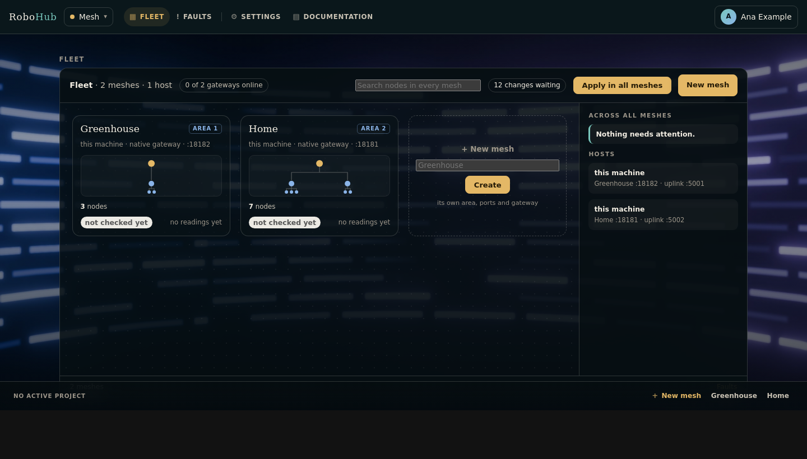
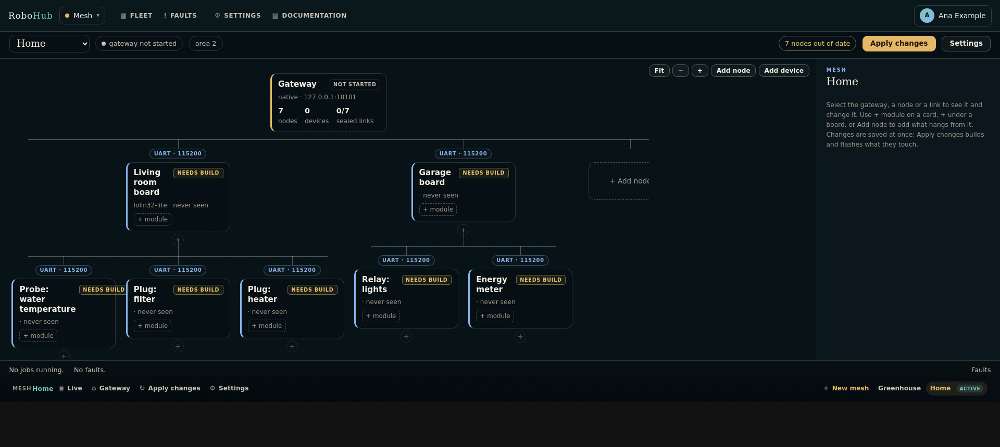

# RoboHub Mesh

Mesh plans and runs the device side of an installation: a gateway, the boards that
report through it, the sensor modules on those boards, the network devices beside
them, the links between them and the firmware each board runs. It draws every mesh
as a tree, writes each board's firmware from the plan, programs it, starts the
gateway, and keeps the readings that come back in the telemetry store the other
applications read. It is the part of RoboHub that knows about boards, not only
about modules.





## Reaching it

| | |
| --- | --- |
| Through the keeper | `http://127.0.0.1:19090/app/mesh/mesh` |
| Its own loopback port | `http://127.0.0.1:8478/mesh` |
| Unit | `mesh` (systemd user unit the keeper writes) |

Mesh is a keeper-hosted application: the keeper installs it, runs it and serves it
under its own origin ({ref}`keeper/index`). Its front door is `/mesh`, the fleet of
every mesh; a mesh opens at `/mesh/p/<project>`.

```sh
# ${ROBOHUB_WORKSPACE} holds robohub, robohub-drivers, robohub-devices and this repository.
rho build .
./build/mesh                 # by hand; normally the keeper starts it
```

### Signing in

Mesh trusts the sessions and tickets the keeper issues. Started by the keeper, it
fetches the keeper's public key from the keeper on its machine; started elsewhere,
it is told where the keeper is with `RHO_AUTH_URL`, sends a person there to sign in,
and fetches the key from `<RHO_AUTH_URL>/auth/public-key`, keeping a copy so a
keeper that is briefly down locks nobody out.

Without a keeper, `RHO_AUTH_STANDALONE=1 ./build/mesh` runs Mesh on its own: it
answers requests from its own machine as the local user and refuses any from
another machine or through a proxy.

### Who may do what

Mesh reads the grants the keeper put in a person's ticket (given under Users &
access in the keeper):

| Grant | May |
| --- | --- |
| `*`, `mesh:*` | everything |
| `mesh:read` | read every mesh |
| `mesh:<mesh>` | read and change that mesh |
| `mesh:<mesh>:read` | read that mesh |

A new mesh, copying one, applying in every mesh and Mesh's own settings need
`mesh:*`. Someone granted particular meshes sees a fleet of those only.

## Pages

The top bar has **Fleet**, **Faults**, **Settings** and **Documentation**; the bar
at the bottom lists every mesh, with **New mesh** beside them. The keeper and the
other applications are in the app switcher.

| Page | Address | What it does |
| --- | --- | --- |
| Fleet | `/mesh` | Every mesh as a card, new meshes, faults across meshes, search |
| Agora | `/mesh/p/<project>` | One mesh as a live tree, edited in the inspector |
| Apply changes | `/mesh/p/<project>/apply` | What differs from what runs, and the jobs that apply it |
| Mesh settings | `/mesh/project/<project>/settings` | Name, description, gateway URL, retention, copy, delete |
| Faults | `/faults` | The fault inbox, cleared one by one |
| Settings | `/settings` | Mesh's own settings |
| Documentation | `/mesh/docs` | This guide, embedded in the program |

### The fleet

`/mesh` shows every mesh this Mesh manages as one panel:

- a card per mesh with its tree drawn small — the gateway, the boards and
  devices under it, their modules — its counts and readings, and whether its
  gateway answers;
- **+ New mesh**, which takes a name and gives the mesh its own folder, area,
  REST port and uplink port, so two meshes run side by side on one machine;
- the inbox of faults across every mesh, and the hosts their gateways run on;
- an activity strip with how many meshes are down and how many faults are open;
- a search that finds a node by its name, id, board, module or device in every
  mesh, and opens it.

Renaming a mesh changes its display name, not its folder. Deleting it stops its
native gateway, removes the folder and frees its place in the fleet.

### The agora

A mesh opens as its agora: the live tree, a bar above it, an inspector beside it
and an activity strip below.

- The gateway is the root, every board branches from its parent, and the badge on
  a branch is the link and names its transport. Modules hang under the board that
  carries them; devices under the gateway or board that owns them.
- Each card says what the mesh reports about it: online with its last reading,
  quiet, or no readings — and, for a board, whether it runs what is planned.
- The bar says whether the gateway answers and offers **Apply changes** when a
  board or the gateway differs from what it runs.

Selecting the gateway, a card or a link badge opens it in the inspector. The project
and the selection are in the address — `/mesh/p/<project>?select=node:<id>` — so two
tabs show two meshes and a link opens the node it names. The wizard's old addresses
(`/mesh/plan`, `/mesh/step/...`, `/mesh/node/<n>`) open the agora with what they
showed selected.

A new mesh opens on the same canvas with three prompts: choose where the gateway
runs, add the first node, apply. On a narrow screen the inspector is a sheet at the
bottom of the page.

### Editing in place

Every edit is made in the inspector and saved at once:

- **Node** — a board's name, description, role (`node`, `relay` or `gateway`), board
  and parent. Moving a board under another keeps its link when the new parent can
  serve it and picks one both can otherwise.
- **Link** — the transport and its settings, for the link the board reaches its
  parent over.
- **Modules** — the modules fitted to the board, with its bus plan.
- **Data** — what the board or device last reported; a device can be polled and
  switched here.
- **Delete** — says what goes with the node (its modules) and asks where what hangs
  from it moves. No other node changes its number or its id.
- **+ node**, **+ module** and **+ device** under any card add what hangs from it.
- The gateway's own inspector sets where it runs and its ports, and builds, starts
  and stops it.

An edit builds nothing and resets nothing. What a board's image is built from — its
board, role, parent, link and the link's settings, its modules, the links it serves,
and the gateway's address when it dials it — is its signature, recorded when the
board is programmed. A board whose plan differs shows as out of date, with what
changed: a new name changes nothing, a new module puts that board alone out of date,
a new link puts the board out of date and asks the gateway or relay serving it to
restart.

Each save raises the node's own revision. A form opened before the node's last save
is refused — "changed elsewhere" — rather than written over it.

#### Nodes and modules

A node is one computer. A sensor module is a node of its own — `kind: module` —
attached to a node, and a node can carry any number of them. A module node is never
built or programmed separately; the image of the node it extends carries it.

Modules are read from `robohub-drivers/boards` on every load of the editor, so a
board added to that checkout appears without rebuilding Mesh. Output and transceiver
boards are left out. The first module attached to a node names the example its
image is built from. A native host has no pins: on a native gateway the module
controls are absent.

Each module says how it reaches a bus in its own manifest:

```yaml
board:
  bus:
    type: i2c
    instance: i2c0
    address: "0x77"        # a part with one address
    addresses: "0x76-0x77" # or the range it can be configured in
    cs: auto               # SPI: the node picks a chip select
```

The Modules tab shows a **bus plan**, which is how several modules become one node:

- 1-Wire modules share `onewire0`.
- I2C modules share `i2c0`; two fixed addresses on the same bus conflict, and a
  module with an address range is assigned one that is free.
- SPI modules share the bus lines and each gets a distinct chip select.
- ADC, PWM, GPIO and UART instances are exclusive.

A conflict is shown on the node and that module is left out of the image, so the
parent still builds. A module that says nothing about its bus is listed without a
plan rather than guessed at.

#### Device nodes

A network device is a node of its own too: an integration from `robohub-devices`
(the Shelly Plug M Gen3, a Hoymiles through an OpenDTU, …) attached to a gateway or a
relay. It is never built or programmed. The device editor chooses the integration,
the transport (`http` or `mqtt`), an HTTP address and the device id. An HTTP device
is polled by Mesh's background worker and can be polled and switched from the Data
tab; an MQTT device reaches Mesh through the broker the keeper runs. Switch actions
appear only for a plug, switch or actuator.

### Links

A link offers only transports both boards can serve: the transports the
`robohub-transport` module declares (`capabilities.transports`) that are also in each
board's `capabilities.links`. Today they are UART, USB, Console, WiFi, Socket,
Ethernet, RS-485, SPI and I2C. `Console` is offered only when the parent is a host,
because the console is the host's byte stream.

| Transport | Fields |
|---|---|
| UART / USB / Console / RS-485 | parent endpoint, node endpoint, baud (RS-485 also its address) |
| WiFi | SSID, password, parent host, node host, TCP port |
| Ethernet / Socket | parent interface or host, node address, port |
| SPI / I2C | parent bus, node bus, address |

### Apply changes and jobs

**Apply changes** lists what differs from what runs and what applying will do:
build each changed board and then flash it, and restart the gateway (or build and
program it, when it is a board). A board's inspector can build and flash that board
alone, and the gateway's can rebuild and restart it.

Applying queues jobs and answers at once. Each job is a script beside the project
with its own log; one runner per mesh works through them in order, so a long build in
one mesh never waits on another, and no page waits on a build. A job that depended on
one that failed is skipped. A job opens its log in the inspector, where a failed one
can be tried again.

A node is built from the modules in the plan: Mesh copies the telemetry node
template, writes `src/sensors.c` from the descriptors in `robohub-drivers`, adds every
compatible module and its driver, writes the Kconfig the board and modules need, and
builds with the commands the examples use:

```sh
rho build -target <board> <project>/boards/node_<number>
rho flash -target <board> -project <project>/boards/node_<number> <image>
```

| Transport | Node link in the firmware |
|---|---|
| UART | a hardware UART (`uart1` on the Pico 2 W) |
| USB / Console | USB CDC |
| WiFi / Socket | the TCP sink |

A flash waits on its board's card, with that board's instruction, until you say the
board is in its programming mode — for a Pico 2 W, BOOTSEL: hold BOOT, tap RST,
release RST, then BOOT. Under WSL the flash shares the board with WSL (Windows asks an
administrator once) and attaches it, re-attaches it after the reboot into BOOTSEL,
and falls back to the bootrom's drive. When a flash succeeds the board runs what is
planned and stops showing as out of date.

### Production builds

A production build hardens a board in ways that cannot be undone: an ESP32 burns
eFuses for secure boot v2 and flash encryption, an RP2350 writes its boot key's hash
into OTP and then boots only images signed with that key. It is **off for every
board** until someone turns it on, on that board, in its inspector's **Access** tab
(the plan says `node.<n>.production: on`). The toggle is shown only for a board
whose platform declares a production plan — the file `rho flash --production`
reads, looked up the same way under `<platform>/production/` (the target's name,
its preset, its family, then `production.json`). An ESP32, an RP2350 and an STM32
(RDP level 1, reversible) have one; an RP2040, an AVR board and a Linux host have
none, and turning it on for them is refused. Turning it on shows the warning: the
steps are irreversible, and a board flashed this way cannot go back to a plain
image.

When it is on:

- the board's `project.conf` carries `CONFIG_RH_PRODUCTION=y`, and the board is out
  of date (*production build changed*) until it is built again;
- if the platform's plan names `RH_SECURE_BOOT_SIGNING_KEY` (ESP32: an RSA-3072 PEM
  key; RP2350: a secp256k1 PEM key), the build needs the mesh's **secure-boot
  signing key**: an absolute path on the machine running Mesh, set in the same tab,
  kept in `signing-key.txt` beside the plan (0600) and never in the plan. Mesh
  never reads the key; the build job is given its path as
  `RH_SECURE_BOOT_SIGNING_KEY`. A production build is **not queued** while no key
  is named, the file is not there, or the group or others can read it;
- the build job ends with `rho flash ... --production --dry-run`, written to
  `production-plan.txt` in the board's folder;
- the flash job waits with that printout — every step, irreversible ones marked —
  as its *waiting for you* text, and a field for the board's name. Only the exact
  name lets it run: Mesh writes what was typed beside the job, and the job hands
  it to `rho flash -target <board> -project <dir> <image> --production` on its
  standard input, where rho flash checks it again. On an RP2350 the job sets
  `RH_PICO_OTP_JSON` to the build's `build/output/<program>.otp.json`. There is no
  way past the typing.

Turning the toggle off makes the next build a plain image again — on an ESP32 or
RP2350 that was already flashed for production, that image will not boot: keep the
key, and build for production.

### Linked meshes

A mesh can report through another: in its gateway's inspector, **Reports through**
names the mesh whose gateway carries it. Its gateway then runs as a relay
(robohub-gateway's relay mode): it dials the parent gateway's uplink as a board of
the parent's mesh, with an id of its own (`relay_uid` in its plan) and the key the
parent derives for that id from its own gateway key, written beside the child as
`relay.key`. The parent listens on its uplink while a mesh reports through it.
Linking or unlinking changes both gateways' signatures, so both show that a restart
applies it.

The parent's agora shows each linked mesh as a node under its gateway that opens to
its own tree; the fleet says which mesh reports through which. A mesh cannot report
through itself or through a mesh that reports through it.

### Across meshes

- **Move to another mesh**, on a board's or device's Node tab, moves it with its id,
  its modules and its history; what hangs from it stays, under its parent. It is out
  of date until it is built with the other mesh's key.
- **Copy as a template**, on a mesh's settings page, starts a new mesh with the plan —
  gateway, boards, modules, links — and its own area and ports, and nothing of what
  was deployed.
- **Apply in all meshes**, on the fleet's bar while changes are waiting, queues each
  mesh's jobs at once.

## Settings

**Mesh's settings** (`/settings`, tabs):

| Tab | What it holds |
| --- | --- |
| General | Vertical or horizontal tabs. |
| Alerts | The `robohub.alert` channels Mesh binds: the log file and threshold; e-mail on/off, recipient, threshold; Telegram on/off, chat, bot token, threshold. |
| Auth | Read-only: the issuer (the keeper), the mode, the sign-in address. |
| Gateway | Read-only: the gateway provider, route, port and the open mesh. |
| Storage | Telemetry retention: raw readings (14 days), minute roll-ups (90), hourly roll-ups (1825), faults (365); WAL checkpoint (5 minutes); retention pass (6 hours); vacuum mode; maximum gateway backoff (60 seconds). |
| Logging | Level, text or JSON, rotating file, size, retention, standard error. |
| Configuration | Read-only: the registry Mesh reads, its plugins, its alert channels. |

**A mesh's settings** (`/mesh/project/<project>/settings`): its name, a short
description, the gateway URL it owns, how long its raw readings are kept, **Copy as a
template** and **Delete project**. The Storage tab's raw window, when set, applies to
every mesh.

A few keys are written in the mesh's `plan.yml` by hand, while Mesh is stopped:

| Key | What it does |
| --- | --- |
| `gateway_tls_cert`, `gateway_tls_key` | Paths on the gateway's machine; a gateway deployed over SSH or ADB then serves HTTPS, and `gateway_url` is an `https://` address. |
| `gateway_audience` | The gateway is another service that produces readings (energy, for one): Mesh polls it with a token for that audience and the `<audience>:gateway` scope. |

## How it connects to the rest

| What | How |
| --- | --- |
| The keeper | Signs people in; installs and runs Mesh; registers it as a client for the services it calls (`deploy.calls: [gateway, energy]`). |
| Gateways | Each mesh's gateway ({ref}`robohub-gateway/index`), started, deployed or programmed by Mesh. |
| `robohub.bus` | Bound to `robohub-provider-mqtt`: Mesh is a user of the keeper's MQTT broker, publishing `+/rpc` and `mesh/+/telemetry`, subscribed to `+/status/#` and `+/online`. |
| `robohub.alert` | Bound to the log, e-mail and Telegram providers. |
| Shared modules | `ui`, `i18n`, `settings`, `forms`, `notifications`, `htmx`, `logging`. |
| Applications | The aquarium and energy read a mesh through {ref}`robohub-provider-mesh/index`, which implements the gateway contract against Mesh's API. |
| Boards and drivers | Read at run time from the local registry's platform modules and `robohub-drivers` / `robohub-devices`: nothing in the planner names a board or a driver a manifest does not. |

### Where the boards and drivers come from

Boards are found by scanning the local registry for platform modules and reading the
manifests under their `boards/` directories. A board declares its roles and hardware
in `capabilities`:

```yaml
capabilities:
  gateway: true
  relay: true
  node: true
  host: false
  links: "uart console usb wifi socket"
  buses: "uart usb i2c spi onewire gpio adc pwm"
  deploy: "flash"
```

A driver declares what it measures and how a node carrying it is built:

```yaml
capabilities:
  sensor: true
  buses: "onewire"
  measures: "temperature"
deployment:
  boards: "pico2w"
  example: "examples/temperature/ds18b20/c/telemetry"
  binary: "build/output/telemetry.elf"
  kconfig: "CONFIG_RH_HAL_ONEWIRE=y CONFIG_RH_BOARD_DS18B20_MODULE=y ..."
```

A platform board also says how a gateway is deployed to it (`deployment.method`:
`adb`, `ssh`, `flash` or `process`, with its architecture, user and path). Adding a
board or a driver therefore needs no rebuild of Mesh; the next page load finds it.

### Gateway tokens and keys

A gateway's API (`/api/v1/`) answers only a caller with a short-lived token the
keeper issued for the audience `gateway`. Each gateway is started with
`GATEWAY_ID` set to its project, and Mesh presents it a token scoped to that gateway
alone, `gateway:<project>:*`, asked for with Mesh's own client credential: a token
taken from the network opens one gateway. The single `gateway_token` an older project
kept is read once into the project's token records so an old installation keeps
working.

Every frame between a board and its gateway is authenticated (robohub-transport's
`secure.h`). Mesh makes the keys and keeps them out of every repository:

- each mesh has a gateway key, made the first time it is needed and kept in its
  folder (`gateway.key`), readable by Mesh's user only, and installed with the gateway
  as `GATEWAY_KEY_FILE`; a key file that exists is never replaced;
- each planned board has an id (`node.<n>.id` in the plan), made once;
- a board's key is derived from the two and its key epoch (`node.<n>.epoch`, 0
  until it is rotated) and written into its build as `src/robohub_secret.h`,
  with the epoch as `RH_DEVICE_KEY_EPOCH` and the gateway's key scope
  (`RH_KEY_SCOPE`, `HMAC-SHA256(K_gw, "rh-scope1")[0:8]`, which a rotated key is
  stored with so a board moved to another mesh ignores the key it stored for its
  old one); no repository tracks it.

A board built that way says hello to its gateway, opens a session, and sends only
sealed frames; its gateway accepts nothing else (on the serial link,
`ALLOW_PLAIN_FRAMES=1` lets plain frames through while boards are reflashed).

Mesh's tree is its user's alone: every folder is `0700`, and what holds a key or a
password — the generated header, `project.conf`, the built `.elf` and `.uf2` — is
`0600` (builds and jobs run under `umask 077`). Mesh closes what an older version
left readable when it starts.

**The node manifest.** Mesh writes `nodes.txt` beside `gateway.key` — one line per
board, `uid|area|node|role|epoch|revoked|areas` — whenever the plan changes and at
every gateway start, and installs it beside the key on the gateway's host. The
gateway admits only the boards it lists, takes a board's readings only for its own
placement, and an announce only from a `relay` for its own areas (a mesh linked
below is one, for its area and those below it).

**Revoke.** A board's inspector has an **Access** tab: **Revoke** takes the board
out of its mesh without re-keying anything — the plan says `node.<n>.revoked`, the
manifest is rewritten, a gateway on this machine reads it within seconds and one on
another host is sent it at once — and **Admit it again** undoes it.

**Rotate key.** The same tab shows the board's key epoch and offers **Rotate key**:
the plan's `node.<n>.epoch` goes up by one, the manifest is rewritten and sent as
for a revocation, and the gateway gives the board its new key under its current
session the next time it hears it (`REKEY`); no flashing. Once the board has
confirmed it, the old key opens nothing, which is how a key that may have been
copied is retired. The tab says what the gateway reports — `rekey.txt` beside the
key for a gateway on this machine, `GET /api/v1/keys` for one on another host:
*waiting for the board to confirm*, *confirmed*, or *cannot rotate* for a board
whose firmware has no store for a key (reflash it). A board is not rotated again
before it confirmed the last rotation: the gateway accepts only the current epoch
and the one before it. A firmware built after a rotation carries the current key,
and a host node fetching its key gets the current epoch's. Whoever recorded the
board's traffic with the old key can unwrap the new one; for a key known to be
stolen, rotate and reflash.

**Host nodes.** A Linux host that speaks the board protocol enrolls with the keeper
and fetches its board id and key from `POST /mesh/api/nodes/key` (through the
keeper, `Authorization: Node <device>:<credential>`): Mesh checks the credential
with the keeper's `/api/nodes/verify` and answers the board planned at the node's
placement, of its current key epoch (`"epoch"` in the answer). A revoked board
gets nothing, the key is never logged, and a client may ask ten times a minute. `rho bootstrap key` is the client.

When a mesh names `gateway_tls_cert` and `gateway_tls_key`, Mesh records and calls
its gateway at an `https://` address, health checks included.

### Applications reading a mesh

An application that reads a mesh declares `deploy.calls: [mesh]` in its manifest. The
keeper registers it as a client, and it asks the keeper for short-lived tokens scoped
to the one project it reads (`mesh:<project>`); nothing is copied into the
application. The **Application tokens** table on a mesh's settings page lists tokens
earlier versions made and can revoke them; Mesh no longer makes them.

Every `/mesh/api` handler verifies the token's audience and project scope: a service
token must carry `mesh:<project>`, `mesh:*` or `*`; a browser session behind the
keeper is held to the person's grants instead. A revoked token is refused without
asking the keeper: the middleware reads the same `revoked.txt` that
`rho auth revoke --jti` writes.

An application registers itself as a client of a project, so Mesh can call it back:

```http
POST /mesh/api/clients/register
Authorization: Bearer <service token>

{"app_name":"robohub-energy","project":"default",
 "instance_id":"energy-8482",
 "callback_url":"http://127.0.0.1:8482/api/energy/mesh/events",
 "topics":"energy.commands,grid.status.*"}
```

Mesh stores the client, its project, its callback and its last-seen time, and returns
a per-client secret; every callback carries `Authorization: Bearer <client secret>`.
A client is online while its last heartbeat is less than ninety seconds old. Topics
match exactly or by a trailing `.*`; publishing routes to the clients whose project
and topics match and to no one else.

## API

All under Mesh's sign-in; a program presents a service token as above.

| Method and path | What it does |
| --- | --- |
| `GET /mesh/api/projects` | the meshes the caller may read |
| `GET /mesh/api/projects/{project}/gateway` | the gateway that project owns |
| `GET /mesh/api/projects/{project}/nodes` | the tree: gateway, boards, modules, devices, each with its id, parent, kind, transport and state |
| `GET /mesh/api/projects/{project}/sources` | the project's signals |
| `GET /mesh/api/projects/{project}/sources/{source}/value` | one signal's reading |
| `GET`/`POST /mesh/api/projects/{project}/sources/{source}/action` | drive an output |
| `GET /mesh/api/projects/{project}/telemetry/status` | rows, newest time, gateway count |
| `GET /mesh/api/projects/{project}/telemetry/latest?source=` | the newest reading |
| `GET /mesh/api/projects/{project}/telemetry/series?source=&from=&to=&step=` | raw readings, or bucket averages when `step` is set (ms) |
| `GET /mesh/api/projects/{project}/telemetry/stream` | live readings (Server-Sent Events) |
| `GET /mesh/api/projects/{project}/telemetry/faults` | the project's faults |
| `GET /mesh/api/projects/{project}/telemetry/gateway` | the poller's state: backoff, next poll, last success, open fault, last error |
| `GET /mesh/api/gateway`, `/mesh/api/sources` | the same for the open mesh |
| `GET /mesh/api/devices` | the devices in the plan |
| `POST /mesh/api/devices/{id}/switch` | switch a plug, switch or actuator |
| `POST /mesh/api/clients/register`, `/heartbeat`, `/publish` | application clients |
| `GET /mesh/api/clients` | the clients, their project, topics, last seen and online flag |

A source names its owner, signal, direction (input or output), unit, the field it
reads, the widget kinds it can feed, and its value and action paths. Its id is
`<node id>.<signal>`, such as `ba06f37ca34ba32c.power`; every node in the plan has an
id made once and kept, so a node added later is never given another's history. The
older form `<kind>.<index>.<signal>` (`device.3.power`) still resolves and is published
as `legacy_id`. The object also carries `module_id`, `driver_id`, `source`, `project`,
`instance` (the node id), `history_path` and, when Mesh knows its origin,
`history_url`. The contract behind it is the `signals:` list in a device
integration's or board's manifest, so a new part is visible to a dashboard without the
dashboard knowing its type.

## The telemetry store

Mesh is the only telemetry store in the installation; applications read it through
`/mesh/api`, never by opening its file. A background worker polls every mesh's
gateway outbox, writes a page in one transaction, advances the cursor and
acknowledges the sequence. The unique key is `(gateway_id, seq)`, so a page repeated
after a failed acknowledgement is ignored. A gateway that does not answer is backed
off from two seconds, doubling to the Storage tab's maximum, and the first failure in
an outage is recorded as one fault.

The store is SQLite in WAL mode with a series index, a latest-value table and minute
and hourly roll-ups, kept for the windows on the Storage tab. A series is keyed by
source and field, never by area and node; a board that reports from a place the plan
gives another is recorded as a fault and kept as its own series. The schema is
`db/schema.sql`, and the code that writes and queries it is Mesh's own Go port,
`plugins/mesh-telemetry`, versioned with Mesh.

## Operating notes

| What | Where |
| --- | --- |
| Meshes | `~/.rho/mesh/projects/<project>/` (`ROBOHUB_MESH_PROJECTS`) |
| A mesh's plan | `plan.yml`, the last 20 revisions under `revisions/` |
| What each board runs | `deployed.txt` |
| Jobs and their logs | `jobs/` |
| Board sources and builds | `boards/node_<number>/` |
| Gateway key, node manifest, token records | `gateway.key`, `nodes.txt`, `tokens.jsonl` (owner-only) |
| Mesh's state: the fleet, application clients | `~/.rho/mesh/state/` (`RHO_MESH_STATE_DIR`), `clients.jsonl` there |
| Telemetry store | `~/.rho/mesh/telemetry.db` (`RHO_TELEMETRY_DB` or `ROBOHUB_MESH_TELEMETRY_DB`) |
| Settings, alert channels | Mesh's app workspace (`~/.rho/keeper/workspaces/mesh` under the keeper) |
| Alerts log | `~/.rho/mesh/alerts.log` |

**Logs.** Mesh logs to standard error, which its unit's journal keeps (the keeper's
**Log** for Mesh, or `journalctl --user -u mesh`); the Logging tab adds a rotating
file. A gateway's and a job runner's own logs sit beside the mesh and keep their last
megabyte once they pass five.

**Backup.** Copy `~/.rho/mesh` (the meshes, their keys and the telemetry store) and
Mesh's workspace. A mesh's `gateway.key` is what every board's key is derived from:
lose it and every board must be rebuilt and flashed.

### Troubleshooting

- **Gateway answers but no readings**: the board runs but its serial path changed. A
  Pico's USB CDC is renumbered by a flash; Mesh uses its stable
  `/dev/serial/by-id/...` path and attaches a shared Pico to WSL.
- **Pico will not program**: put it in BOOTSEL, then press **The board is ready: flash
  it** on its flash job. The job's log says which way it was written.
- **A board build stops at the foreign interface or the target**: the `rho-cimport`
  and `rho-target` components installed are older than the board's manifest. Install
  the current ones from the registry and enable them
  (`rho module install rho-target@<version>`, then `rho module enable`).
- **FAULT temperature**: the node is heard but the sensor is not answering. Check the
  DS18B20 wiring (GP28, 3V3, GND) and its 4.7 kΩ pull-up; the node brings the sensor
  up again every five seconds at most.
- **The page looks stale after a rebuild**: templates are embedded in the program;
  redeploy Mesh from the keeper and hard-refresh the browser.
- **The native gateway's address**: `127.0.0.1` on Mesh's machine, and the machine's
  network address for another one.

### Tests

```sh
rho test .
```

The unit suites check the plan as text, the transport rule and the signatures that
say what a board's image is built from. The smoke suite builds Mesh and walks it over
HTTP: a mesh planned in place, the bus plan and its conflicts, the plan's revisions,
numbers kept across a delete, the old addresses, the fleet and its ports, stale saves
refused, a native gateway started as a job and found online, and a Pico 2 W board
built in the background with its flash waiting for BOOTSEL. The production smoke runs Mesh
with a stand-in `rho`, so nothing is built or burned: the toggle offered only where
the platform has a plan, a production build refused without the signing key or with
one others can read, and the flash waiting on the dry run's steps until the board's
name is typed, then handed that name on its input.
